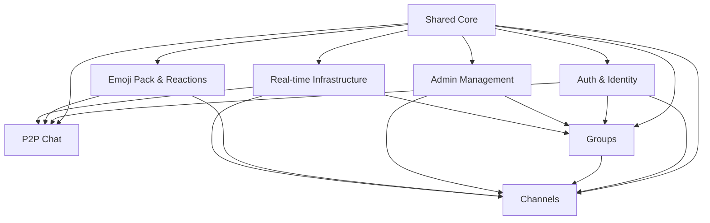

# NexussGram — Execution Plan

## Component Graph

## Components

### C0 — Shared Core
**Status**: pending
**Purpose**: Types, Zod schemas, Prisma client, constants, utilities shared across packages.
**Owns**: `packages/shared/src/`
**Depends on**: none
**Parallel with**: none (blocking)
**Todos**:
- [ ] Initialize pnpm monorepo with 3 packages
- [ ] Configure TypeScript, ESLint, Prettier, Vitest for each package
- [ ] Define Prisma schema (User, Chat, Message, Group, GroupMember, Channel, ChannelMember, Reaction, AdminAction, Contact, EmojiPack)
- [ ] Generate Prisma client
- [ ] Create Zod schemas for all API boundaries
- [ ] Shared constants: message types, roles, admin actions, presence states
- [ ] Utility functions: date formatting (human-readable), validation helpers
**Exit Gates**:
- [ ] G0.1: `pnpm -C packages/shared build` passes
- [ ] G0.2: `pnpm -C packages/shared test` passes
- [ ] G0.3: Prisma client generates without errors
- [ ] G0.4: Zod schemas export and validate correctly

---

### C1 — Auth & Identity
**Status**: pending
**Purpose**: Phone + Google OAuth signup/login, session management, profile (username/phone), public/private search.
**Owns**: `packages/server/src/auth/`, `packages/client/src/features/auth/`
**Depends on**: C0
**Parallel with**: C7 (real-time infra can start in parallel)
**Todos**:
- [ ] Server: Better Auth setup with phone + Google providers
- [ ] Server: JWT session, refresh tokens, logout
- [ ] Server: Profile endpoints (get, update username, avatar)
- [ ] Server: User search by username (public only), phone (contacts only)
- [ ] Server: Presence baseline (online/offline/lastSeen)
- [ ] Client: Auth pages (phone input, OTP, Google button, profile setup)
- [ ] Client: Auth context, protected routes, token refresh
- [ ] Client: Profile settings (username, avatar, privacy)
- [ ] Client: Contact sync (upload contacts, find matches)
**Exit Gates**:
- [ ] G1.1: Signup with phone → OTP → profile creation works (E2E)
- [ ] G1.2: Signup with Google → profile creation works (E2E)
- [ ] G1.3: Username search returns only public users (unit + integration)
- [ ] G1.4: Session persists across refresh; refresh token rotates (integration)
- [ ] G1.5: `pnpm -C packages/server test` auth tests pass; `pnpm -C packages/client test` auth tests pass

---

### C7 — Real-time Infrastructure
**Status**: pending
**Purpose**: Socket.io server + client, namespaces, connection auth, reconnection, presence broadcasting.
**Owns**: `packages/server/src/realtime/`, `packages/client/src/features/realtime/`
**Depends on**: C0
**Parallel with**: C1
**Todos**:
- [ ] Server: Socket.io server with Fastify integration
- [ ] Server: Namespaces: `/chat`, `/presence`, `/notifications`
- [ ] Server: Connection auth via JWT; user rooms; presence tracking
- [ ] Server: Typing indicators, read receipts, message delivery ack
- [ ] Client: Socket connection manager, auto-reconnect, event types
- [ ] Client: Presence hook (online/offline/lastSeen for user list)
- [ ] Client: Typing indicator hook, read receipt hook
**Exit Gates**:
- [ ] G7.1: Two clients connect, join rooms, exchange events (integration)
- [ ] G7.2: Presence updates broadcast correctly (online→offline→lastSeen)
- [ ] G7.3: Reconnection recovers state (manual test)
- [ ] G7.4: `pnpm -C packages/server test` realtime tests pass

---

### C2 — P2P Chat
**Status**: pending
**Purpose**: One-to-one chat window, message bubbles (left/right), contact save, search by username.
**Owns**: `packages/server/src/chat/`, `packages/client/src/features/chat/`
**Depends on**: C0, C1, C7
**Parallel with**: C3, C6 (after C1, C7 done)
**Todos**:
- [ ] Server: Chat model (participants, lastMessage, unreadCount)
- [ ] Server: Message CRUD (send, edit, delete, pagination)
- [ ] Server: Socket handlers: sendMessage, editMessage, deleteMessage, markRead
- [ ] Server: Contact save (user saves another user)
- [ ] Client: Chat list sidebar (recent chats, contacts, search)
- [ ] Client: Chat window: messages, bubbles (own right, other left + avatar)
- [ ] Client: Message input: text, emoji picker (from C6), reply, forward
- [ ] Client: Online/offline/lastSeen badge with human-readable time
- [ ] Client: Click @username → navigate to chat
- [ ] Client: Save/unsave contact
**Exit Gates**:
- [ ] G2.1: User A searches User B by username, opens chat, sends message (E2E)
- [ ] G2.2: Messages appear in real-time for both users (E2E)
- [ ] G2.3: Own messages right/bubble, other messages left + avatar (visual regression)
- [ ] G2.4: Presence shows "online", "2 min ago", "1 hour ago", "yesterday" (unit)
- [ ] G2.5: Save contact adds to contact list; unsave removes (integration)
- [ ] G2.6: `pnpm -C packages/server test` chat tests pass; `pnpm -C packages/client test` chat tests pass

---

### C6 — Emoji Pack & Reactions
**Status**: pending
**Purpose**: Complete emoji picker library with categories, search, recent, skin tones; reaction system.
**Owns**: `packages/shared/src/emoji/`, `packages/client/src/features/emoji/`, `packages/server/src/reactions/`
**Depends on**: C0
**Parallel with**: C2, C4 (after C0 done)
**Todos**:
- [ ] Shared: Emoji dataset (Unicode 15.1), categories, keywords, skin tones
- [ ] Shared: Emoji picker component (headless, accessible)
- [ ] Client: EmojiPicker React component: search, categories, recent, skin tones, virtualized list
- [ ] Client: Emoji input integration (message input, reaction picker)
- [ ] Server: Reaction model (messageId, userId, emoji, createdAt)
- [ ] Server: Reaction endpoints: add, remove, list
- [ ] Server: Socket events: reactionAdded, reactionRemoved
- [ ] Client: Reaction UI on messages (click to react, picker, count badge)
- [ ] Channel-specific: curated emoji set for reactions (configurable)
**Exit Gates**:
- [ ] G6.1: Emoji picker opens, searches, selects, inserts into input (visual + unit)
- [ ] G6.2: Reaction on message appears in real-time for all (E2E)
- [ ] G6.3: Channel reaction limited to curated set (integration)
- [ ] G6.4: Skin tones persist per emoji (unit)
- [ ] G6.5: `pnpm -C packages/shared test` emoji tests pass

---

### C3 — Groups
**Status**: pending
**Purpose**: Create groups, invite from contacts, acceptance flow, member management.
**Owns**: `packages/server/src/groups/`, `packages/client/src/features/groups/`
**Depends on**: C0, C1, C7
**Parallel with**: C2, C6
**Todos**:
- [ ] Server: Group model (name, avatar, ownerId, description, settings)
- [ ] Server: GroupMember model (userId, groupId, role, status: invited/accepted/left/banned, joinedAt)
- [ ] Server: Group CRUD, invite (creates invited member), accept/reject invite
- [ ] Server: Member management: promote/demote admin, remove, ban (timed), mute
- [ ] Server: Socket: groupCreated, memberJoined, memberLeft, memberRoleChanged, memberBanned
- [ ] Client: Group list, create group modal (select contacts)
- [ ] Client: Group chat window (sender name + avatar left, own right)
- [ ] Client: Group info: members, admins, invite link, leave group
- [ ] Client: Invite flow: sent → pending → accept/reject → member
**Exit Gates**:
- [ ] G3.1: User creates group, adds contacts, they receive invite (E2E)
- [ ] G3.2: Invite acceptance makes them member; reject leaves as invited (integration)
- [ ] G3.3: Group messages show sender name + avatar left, own right (visual)
- [ ] G3.4: Admin can promote/demote, remove, ban (timed), mute (integration)
- [ ] G3.5: `pnpm -C packages/server test` group tests pass; `pnpm -C packages/client test` group tests pass

---

### C5 — Admin Management
**Status**: pending
**Purpose**: Owner assigns admins; admins have mute, ban (timed), warn privileges; privilege matrix.
**Owns**: `packages/server/src/admin/`, `packages/client/src/features/admin/`
**Depends on**: C0, C1, C3, C4
**Parallel with**: none (depends on groups + channels)
**Todos**:
- [ ] Server: AdminAction model (actorId, targetId, groupId/channelId, action, reason, expiresAt)
- [ ] Server: Privilege matrix: owner > admin > member; actions per role
- [ ] Server: Endpoints: assign/remove admin, mute, ban (with duration), warn, unban
- [ ] Server: Ban enforcement: blocked from sending, auto-unban on expiry
- [ ] Server: Mute enforcement: blocked from sending for duration
- [ ] Client: Admin panel in group/channel info (owners see all, admins see subset)
- [ ] Client: Member list with action menu per role
- [ ] Client: Ban/mute modals with duration picker, reason input
- [ ] Client: Admin action log/history
**Exit Gates**:
- [ ] G5.1: Owner assigns admin; admin sees admin panel (E2E)
- [ ] G5.2: Admin mutes user; user cannot send until expiry (integration)
- [ ] G5.3: Admin bans user for 1h; user auto-unbanned; cannot rejoin during ban (integration)
- [ ] G5.4: Admin warns user; warning recorded in log (integration)
- [ ] G5.5: Non-admin cannot perform admin actions (authorization test)
- [ ] G5.6: `pnpm -C packages/server test` admin tests pass

---

### C4 — Channels
**Status**: pending
**Purpose**: Admin-only posting, member reactions, comment section linked to group.
**Owns**: `packages/server/src/channels/`, `packages/client/src/features/channels/`
**Depends on**: C0, C1, C3, C6, C7
**Parallel with**: none (depends on groups + emoji + realtime)
**Todos**:
- [ ] Server: Channel model (title, username, avatar, description, ownerId, linkedGroupId?)
- [ ] Server: ChannelMember model (userId, channelId, role: owner/admin/member, joinedAt)
- [ ] Server: Post model (channelId, authorId, content, media, reactions, commentGroupId)
- [ ] Server: Only owner/admin can create posts; members react (curated emoji from C6)
- [ ] Server: Comment section: each post links to a group (existing or auto-created)
- [ ] Server: Socket: channelPost, channelReaction, channelComment
- [ ] Client: Channel list, join/leave, channel view (posts feed)
- [ ] Client: Post composer (owner/admin only), reaction bar (curated emojis)
- [ ] Client: Comment button → opens linked group chat
- [ ] Client: Channel info: admins, members count, linked group
**Exit Gates**:
- [ ] G4.1: Owner creates channel, posts message; member sees, reacts (E2E)
- [ ] G4.2: Member cannot post; only react with curated emojis (authorization)
- [ ] G4.3: Comment section opens linked group; messages sync (E2E)
- [ ] G4.4: Channel username searchable; public join via link (integration)
- [ ] G4.5: `pnpm -C packages/server test` channel tests pass; `pnpm -C packages/client test` channel tests pass

---

## Execution Order

1. **C0** (Shared Core) — blocks everything
2. **C1** (Auth) + **C7** (Realtime) — parallel, both needed for chat
3. **C6** (Emoji) — parallel with C2/C3, needed for reactions
4. **C2** (P2P Chat) + **C3** (Groups) — parallel after C1+C7
5. **C4** (Channels) — after C3+C6
6. **C5** (Admin) — after C3+C4

## Risk Register

| Risk | Likelihood | Impact | Mitigation |
|---|---|---|---|
| Socket.io scaling beyond single node | Medium | High | Design for Redis adapter from start; defer multi-node to v2 |
| Emoji dataset size / bundle | Medium | Medium | Tree-shake, virtualized picker, dynamic import |
| Contact upload privacy | High | High | Hash phone numbers before upload; never store raw |
| Google OAuth setup complexity | Low | Medium | Document exact console steps; provide mock for dev |
| Real-time message ordering | Medium | High | Server-side sequencing; client dedup by temp ID |

## Open Questions
1. File/media uploads: S3-compatible or local? (Defer to post-MVP)
2. Push notifications: Firebase/Expo or custom? (Defer)
3. Message editing/deletion time limits? (Decide in C2)
4. Channel username uniqueness: global or per-user? (Global, like Telegram)